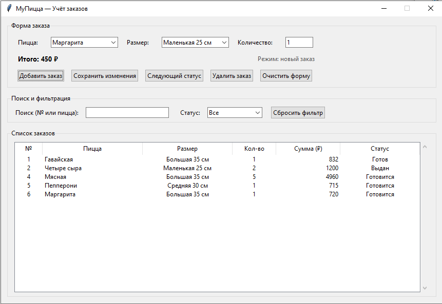
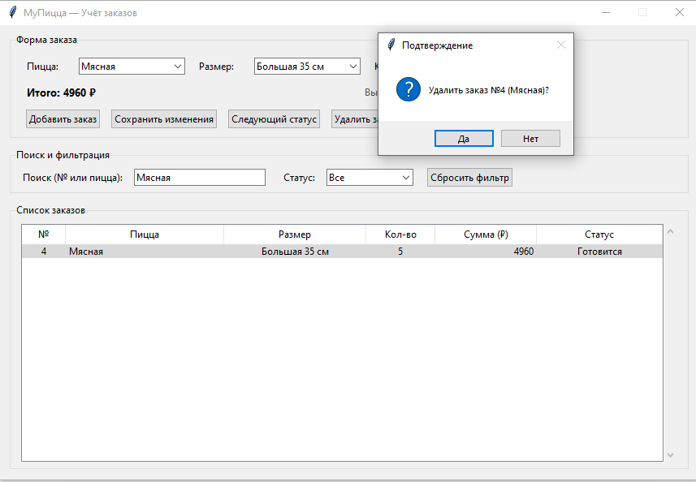

# MyПицца — учёт заказов пиццерии

**Авторы:** Ананьев Александр, Ларионов Дмитрий, группа 12ТЭС-26. **Срок:** 3 спринта по 2 недели (всего 6 недель). **Статус:** выпуск `v1.0` реализован и протестирован.

## Заказчик и проблема
«MyПицца» — пиццерия, где ранее заказы вели вручную на бумаге, из-за чего возникали ошибки при расчёте стоимости и путаница со статусами готовности. Приложение автоматизирует приём, расчёт суммы и отслеживание заказов.

## Реализованная функциональность
- Добавление заказа (выбор пиццы из 5 позиций, размера 25/30/35 см, количества от 1 до 50) с мгновенным расчётом суммы.
- Просмотр списка заказов в таблице и загрузка выбранного заказа в форму по клику.
- Редактирование параметров заказа с валидацией ввода и пересчётом стоимости.
- Последовательный перевод по статусам: «Готовится» → «Готов» → «Выдан».
- Поиск по номеру или названию пиццы и фильтрация по статусу.
- Удаление выбранного заказа с окном подтверждения.

## Установка и запуск
1. Убедитесь, что установлен Python 3.11 или новее с модулем Tkinter.
2. Склонируйте репозиторий и перейдите в его корневую папку:
   ```bash
   git clone https://github.com
   cd zadacha.19.11
   ```
3. Запустите приложение (внешние библиотеки не требуются):
   ```bash
   python src/main.py
   ```
4. **Примеры для демонстрации:** «Пепперони» (Средняя 30 см, 2 шт. → 1430 ₽), «Маргарита» (Большая 35 см, 1 шт. → 720 ₽), «Четыре сыра» (Маленькая 25 см, 3 шт. → 1800 ₽).

## Технологический стек
Python 3 + Tkinter (`ttk.Treeview`, `messagebox`), хранение данных в списке словарей в оперативной памяти, Git и GitHub.

## Скриншоты интерфейса



## Документация и тестирование
- [Устав проекта](docs/01_Устав_проекта.md)
- [План проекта](docs/02_План_проекта.md)
- [Требования](docs/03_Требования.md)
- [Техническое задание](docs/04_Техническое_задание.md)
- [Протоколы встреч](docs/05_Протокол_встречи.md)
- [Отчёты о статусе](docs/06_Отчёт_о_статусе.md)
- [Документация продукта](docs/07_Документация_продукта.md)
- [Ручные проверки качества](tests/manual_checks.md)
